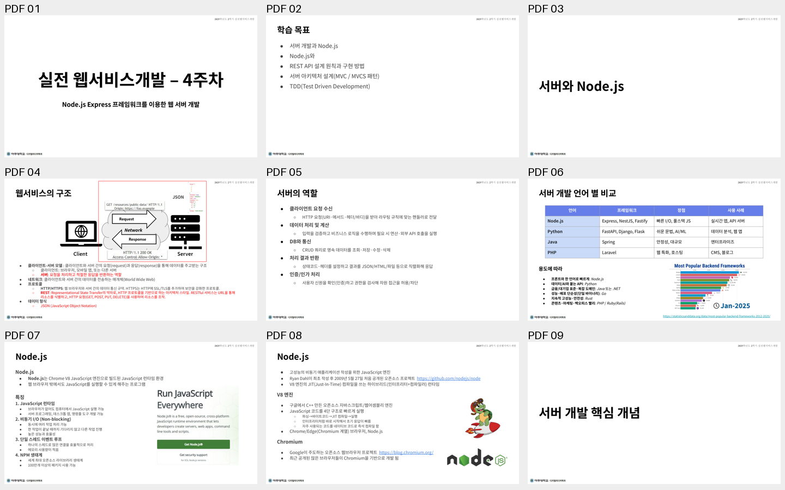
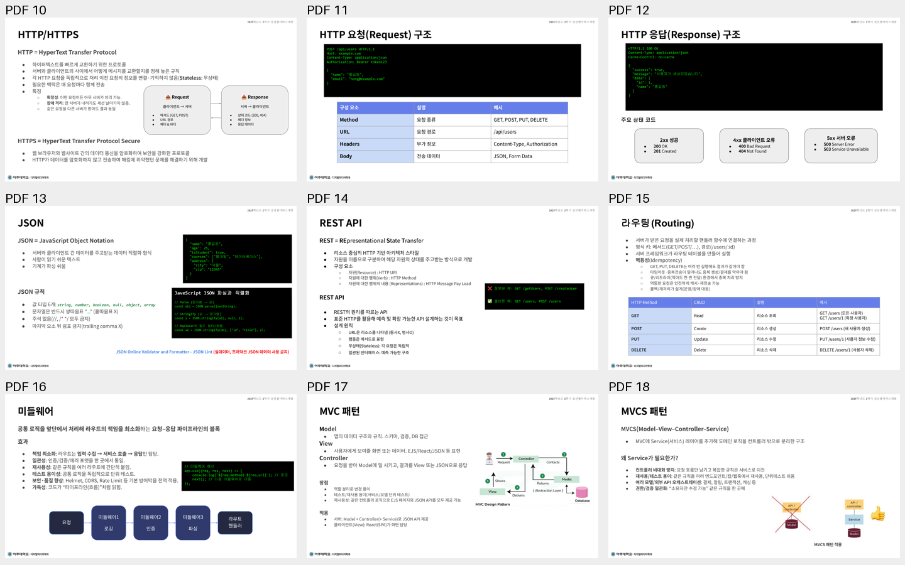
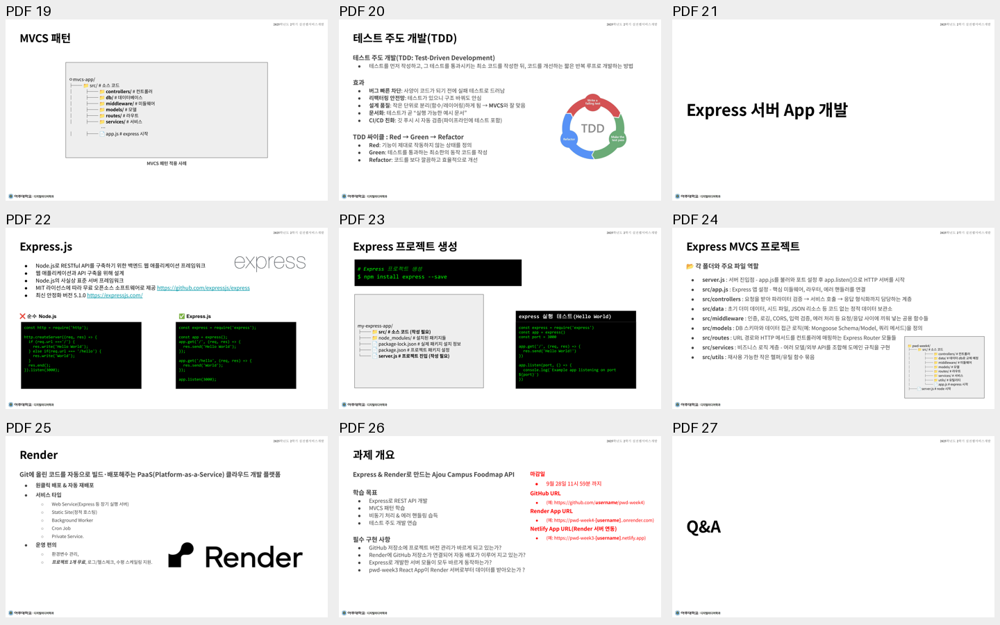
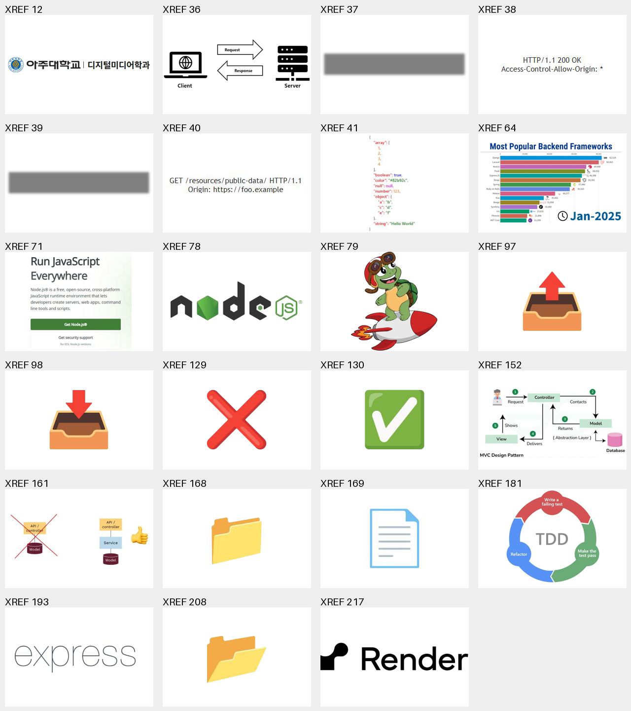

# 원본 PDF 페이지·이미지 목록

원본의 텍스트·그림·링크를 추출한 자료다. 내용 판단과 2026년 업데이트는 [검토 보고서](review.ko.md)에 기록한다.

27쪽 · 고유 이미지 23개 · 이미지 배치 73회 · 실제 PDF 링크 7개

이미지 개수는 투명도 마스크를 제외한 PDF 객체 기준이다. 같은 아이콘·로고를 중복 저장하지 않는다. PNG는 원본 이미지와 해당 투명도 마스크를 합친 추출본이다.

## 전체 페이지

| PDF | 주제 | 텍스트 | 원본 화면 | 현재 06 화면 |
| --- | --- | --- | --- | --- |
| 01 | 실전 웹서비스개발 ‒ 4주차 | [추출](text/page-01.txt) | [1600px PNG](pages/page-01.png) | 1 |
| 02 | 학습 목표 | [추출](text/page-02.txt) | [1600px PNG](pages/page-02.png) | 2 |
| 03 | 서버와 Node.js | [추출](text/page-03.txt) | [1600px PNG](pages/page-03.png) | 3 |
| 04 | 웹서비스의 구조 | [추출](text/page-04.txt) | [1600px PNG](pages/page-04.png) | 4 |
| 05 | 서버의 역할 | [추출](text/page-05.txt) | [1600px PNG](pages/page-05.png) | 5 |
| 06 | 서버 개발 언어 별 비교 | [추출](text/page-06.txt) | [1600px PNG](pages/page-06.png) | 6 |
| 07 | Node.js | [추출](text/page-07.txt) | [1600px PNG](pages/page-07.png) | 7 |
| 08 | Node.js | [추출](text/page-08.txt) | [1600px PNG](pages/page-08.png) | 8 |
| 09 | 서버 개발 핵심 개념 | [추출](text/page-09.txt) | [1600px PNG](pages/page-09.png) | 9 |
| 10 | HTTP/HTTPS | [추출](text/page-10.txt) | [1600px PNG](pages/page-10.png) | 10 |
| 11 | HTTP 요청(Request) 구조 | [추출](text/page-11.txt) | [1600px PNG](pages/page-11.png) | 11 |
| 12 | HTTP 응답(Response) 구조 | [추출](text/page-12.txt) | [1600px PNG](pages/page-12.png) | 12 |
| 13 | JSON | [추출](text/page-13.txt) | [1600px PNG](pages/page-13.png) | 13 |
| 14 | REST API | [추출](text/page-14.txt) | [1600px PNG](pages/page-14.png) | 14 |
| 15 | 라우팅(Routing) | [추출](text/page-15.txt) | [1600px PNG](pages/page-15.png) | 15 |
| 16 | 미들웨어 | [추출](text/page-16.txt) | [1600px PNG](pages/page-16.png) | 16 |
| 17 | MVC 패턴 | [추출](text/page-17.txt) | [1600px PNG](pages/page-17.png) | 17 |
| 18 | MVCS 패턴 | [추출](text/page-18.txt) | [1600px PNG](pages/page-18.png) | 18 |
| 19 | MVCS 패턴 | [추출](text/page-19.txt) | [1600px PNG](pages/page-19.png) | 19 |
| 20 | 테스트 주도 개발(TDD) | [추출](text/page-20.txt) | [1600px PNG](pages/page-20.png) | 20 |
| 21 | Express 서버 App 개발 | [추출](text/page-21.txt) | [1600px PNG](pages/page-21.png) | 21 |
| 22 | Express.js | [추출](text/page-22.txt) | [1600px PNG](pages/page-22.png) | 22 |
| 23 | Express 프로젝트 생성 | [추출](text/page-23.txt) | [1600px PNG](pages/page-23.png) | 23 |
| 24 | Express MVCS 프로젝트 | [추출](text/page-24.txt) | [1600px PNG](pages/page-24.png) | 24 |
| 25 | Render  | [추출](text/page-25.txt) | [1600px PNG](pages/page-25.png) | 25 |
| 26 | 과제 개요 | [추출](text/page-26.txt) | [1600px PNG](pages/page-26.png) | 26 |
| 27 | Q&A | [추출](text/page-27.txt) | [1600px PNG](pages/page-27.png) | 27 |

## 이미지 자산

| ID | 원본 쪽 | 크기 | 원본 용도·보존 기준 |
| --- | --- | --- | --- |
| [ajou-footer](images/ajou-footer.png) | 1, 2, 3, 4, 5, 6, 7, 8, 9, 10, 11, 12, 13, 14, 15, 16, 17, 18, 19, 20, 21, 22, 23, 24, 25, 26, 27 | 409×55 | 반복 학교·학과 로고 · 해당 슬라이드 문맥과 구성 요소 보존; 페이지 배치는 05 형식에 맞춰 최적화 |
| [client-server-network](images/client-server-network.png) | 4 | 897×320 | 클라이언트·네트워크·서버 도식 바탕 · 해당 슬라이드 문맥과 구성 요소 보존; 페이지 배치는 05 형식에 맞춰 최적화 |
| [response-message-shadow](images/response-message-shadow.png) | 4 | 714×138 | 응답 메시지 패널의 그림자 · 해당 슬라이드 문맥과 구성 요소 보존; 페이지 배치는 05 형식에 맞춰 최적화 |
| [response-message](images/response-message.png) | 4 | 247×37 | HTTP 200·Access-Control-Allow-Origin 응답 메시지 · 해당 슬라이드 문맥과 구성 요소 보존; 페이지 배치는 05 형식에 맞춰 최적화 |
| [request-message-shadow](images/request-message-shadow.png) | 4 | 709×138 | 요청 메시지 패널의 그림자 · 해당 슬라이드 문맥과 구성 요소 보존; 페이지 배치는 05 형식에 맞춰 최적화 |
| [request-message](images/request-message.png) | 4 | 285×43 | GET·Origin 요청 메시지 · 해당 슬라이드 문맥과 구성 요소 보존; 페이지 배치는 05 형식에 맞춰 최적화 |
| [json-sample](images/json-sample.png) | 4 | 163×295 | JSON 예시 이미지 · 해당 슬라이드 문맥과 구성 요소 보존; 페이지 배치는 05 형식에 맞춰 최적화 |
| [backend-ranking-2025](images/backend-ranking-2025.png) | 6 | 1920×1080 | Jan-2025 백엔드 프레임워크 순위 이미지 · 해당 슬라이드 문맥과 구성 요소 보존; 페이지 배치는 05 형식에 맞춰 최적화 |
| [node-homepage-2025](images/node-homepage-2025.png) | 7 | 470×438 | Node.js 홈페이지 소개·다운로드 화면 캡처 · 해당 슬라이드 문맥과 구성 요소 보존; 페이지 배치는 05 형식에 맞춰 최적화 |
| [nodejs-logo](images/nodejs-logo.png) | 8 | 267×80 | Node.js 로고 · 해당 슬라이드 문맥과 구성 요소 보존; 페이지 배치는 05 형식에 맞춰 최적화 |
| [rocket-turtle-illustration](images/rocket-turtle-illustration.png) | 8 | 698×800 | 로켓을 탄 거북이 삽화 · 해당 슬라이드 문맥과 구성 요소 보존; 페이지 배치는 05 형식에 맞춰 최적화 |
| [request-icon](images/request-icon.png) | 10 | 136×128 | Request 아이콘 · 해당 슬라이드 문맥과 구성 요소 보존; 페이지 배치는 05 형식에 맞춰 최적화 |
| [response-icon](images/response-icon.png) | 10 | 136×128 | Response 아이콘 · 해당 슬라이드 문맥과 구성 요소 보존; 페이지 배치는 05 형식에 맞춰 최적화 |
| [cross-icon](images/cross-icon.png) | 14, 22 | 136×128 | 오류 표시 아이콘 · 해당 슬라이드 문맥과 구성 요소 보존; 페이지 배치는 05 형식에 맞춰 최적화 |
| [check-icon](images/check-icon.png) | 14, 22 | 136×128 | 확인 표시 아이콘 · 해당 슬라이드 문맥과 구성 요소 보존; 페이지 배치는 05 형식에 맞춰 최적화 |
| [mvc-diagram](images/mvc-diagram.png) | 17 | 738×382 | MVC 요청·응답 관계 · 해당 슬라이드 문맥과 구성 요소 보존; 페이지 배치는 05 형식에 맞춰 최적화 |
| [mvcs-diagram](images/mvcs-diagram.png) | 18 | 523×222 | Service를 추가한 계층 도식 · 해당 슬라이드 문맥과 구성 요소 보존; 페이지 배치는 05 형식에 맞춰 최적화 |
| [folder-icon](images/folder-icon.png) | 19, 23, 24 | 136×128 | 반복 폴더 아이콘 · 해당 슬라이드 문맥과 구성 요소 보존; 페이지 배치는 05 형식에 맞춰 최적화 |
| [file-icon](images/file-icon.png) | 19, 23, 24 | 136×128 | 반복 파일 아이콘 · 해당 슬라이드 문맥과 구성 요소 보존; 페이지 배치는 05 형식에 맞춰 최적화 |
| [tdd-cycle](images/tdd-cycle.png) | 20 | 1024×680 | Red·Green·Refactor 반복 도식 · 해당 슬라이드 문맥과 구성 요소 보존; 페이지 배치는 05 형식에 맞춰 최적화 |
| [express-logo](images/express-logo.png) | 22 | 465×141 | 원본 Express 로고 · 해당 슬라이드 문맥과 구성 요소 보존; 페이지 배치는 05 형식에 맞춰 최적화 |
| [project-folder-icon](images/project-folder-icon.png) | 24 | 136×128 | 프로젝트 루트 폴더 아이콘 · 해당 슬라이드 문맥과 구성 요소 보존; 페이지 배치는 05 형식에 맞춰 최적화 |
| [render-logo](images/render-logo.png) | 25 | 400×120 | Render 로고 · 해당 슬라이드 문맥과 구성 요소 보존; 페이지 배치는 05 형식에 맞춰 최적화 |

## 합성·벡터 도식

다음 도식은 이미지 객체 하나로 추출되지 않는다. 원본 페이지의 해당 구역을 그대로 렌더링한 자산이다.

- PDF 4: [제목과 요청/응답·JSON을 포함한 원본 상단 합성 도식](crops/client-server-composite.png)
- PDF 16: [PDF 벡터·텍스트로 구성한 미들웨어 처리 흐름](crops/middleware-pipeline.png)
- PDF 19: [아이콘·텍스트가 결합된 원본 MVCS 폴더 트리](crops/mvcs-file-tree.png)
- PDF 24: [아이콘·텍스트가 결합된 Express 프로젝트 트리](crops/express-file-tree.png)

## 원본 전체 미리보기

## 추출 이미지 미리보기

